  
  
  

---

### 👋 Sobre mim

Sou desenvolvedor full-stack desde 2015, hoje focado em **produto + IA aplicada**. Gosto de pegar uma ideia, desenhar a spec, escrever os testes primeiro e levar até produção — API, app, web e infraestrutura.

- 🏗️ Construo **SaaS e apps** com TypeScript de ponta a ponta (NestJS, Prisma, React, React Native/Expo)
- 🤖 Crio **times de agentes de IA** que planejam, codam, revisam PRs e fazem QA
- 🧪 Trabalho com **Spec-Driven Development + TDD** — PR só entra com teste verde
- 🚀 Coloco tudo no ar com **Docker, Coolify, Terraform, Vercel e Cloudflare**
- 🌱 Estudando agora: **Rust** (apps nativos leves) e **Go** (workers de alta vazão)

---

### 🛠️ Stack

**Linguagens** 

**Backend & Dados** 

**Front & Mobile** 

**Infra & Ferramentas** 

---

### 🚀 No que estou trabalhando

| Projeto | O que é | Stack |
|---|---|---|
| 🍳 **Open Cooking** | Plataforma de receitas com IA: app, web, API e workers de processamento | React Native · React · NestJS · Python · Go |
| ⚽ **TAKKA** | Plataforma de futebol para torcedores, jogadores e clubes, em PT/EN/ES | React Native · Next.js · NestJS |
| 🚗 **MyAutoHub** | CRM automotivo com leads, WhatsApp Cloud API e integrações de marketplace | NestJS · Prisma · React |
| 🔍 **pr-reviewer** | Revisor de PR que junta scanners determinísticos (segredos, injeção, auth) com uma passada de LLM | TypeScript · GitHub Actions |
| 🤖 **AI Team Agents** | Times de agentes que refinam, desenvolvem e publicam projetos sozinhos | Python · Claude · MCP |

---

### ⭐ Projetos abertos

<table>
<tr>
<td width="50%" valign="top">

#### 🎮 [hud-monitor](https://github.com/douglasmoura-dev/hud-monitor)
Monitor de sistema para Windows em estilo **HUD gamer**: transparente, sempre por cima e com menos de 30 MB de RAM. Mostra CPU, GPU, rede e os **limites de uso das IAs** (Claude, Codex, Gemini, Cursor).

`Rust` `Slint`

</td>
<td width="50%" valign="top">

#### 📅 [mcp-google-calendar](https://github.com/douglasmoura-dev/mcp-google-calendar)
Servidor **MCP (Model Context Protocol)** que dá a agentes de IA acesso ao Google Calendar para criar e gerenciar eventos.

`TypeScript` `NestJS` `MCP`

</td>
</tr>
<tr>
<td width="50%" valign="top">

#### 💬 [opencode-telegram-server](https://github.com/douglasmoura-dev/opencode-telegram-server)
Bot do Telegram que roda tarefas de desenvolvimento com IA (Gemini, Claude, GPT via OpenRouter), integrado ao GitHub.

`Docker` `OpenCode` `Telegram`

</td>
<td width="50%" valign="top">

#### 📚 [py-ai-docs-notion](https://github.com/douglasmoura-dev/py-ai-docs-notion)
Lê páginas do Notion e responde perguntas sobre elas em um chat com LLM.

`Python` `Gemini` `Notion API`

</td>
</tr>
<tr>
<td width="50%" valign="top">

#### 💥 [popcrash](https://github.com/douglasmoura-dev/popcrash)
Portal de notícias de **games, filmes, séries e cultura pop**.

`Next.js` `PostgreSQL` `Docker`

</td>
<td width="50%" valign="top">

#### 🖼️ [image-remove-bg](https://github.com/douglasmoura-dev/image-remove-bg)
API que recebe uma imagem e devolve sem fundo, usando IA.

`Python` `Flask` `rembg`

</td>
</tr>
</table>

---

### 🐍 Contribuições

<picture>
  <source media="(prefers-color-scheme: dark)" srcset="https://raw.githubusercontent.com/douglasmoura-dev/douglinhasmoura/output/github-contribution-grid-snake-dark.svg" />
  <source media="(prefers-color-scheme: light)" srcset="https://raw.githubusercontent.com/douglasmoura-dev/douglinhasmoura/output/github-contribution-grid-snake.svg" />
  
</picture>

---

**Bora conversar sobre produto, IA ou futebol?** Me chama no [LinkedIn](https://www.linkedin.com/in/douglas-moura-19546298/). ⚡

